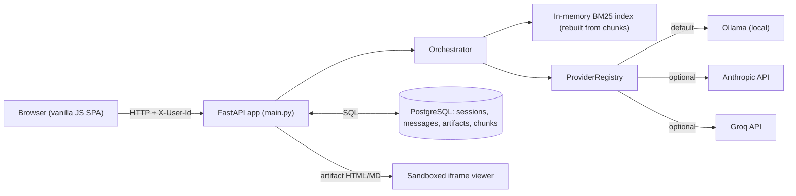
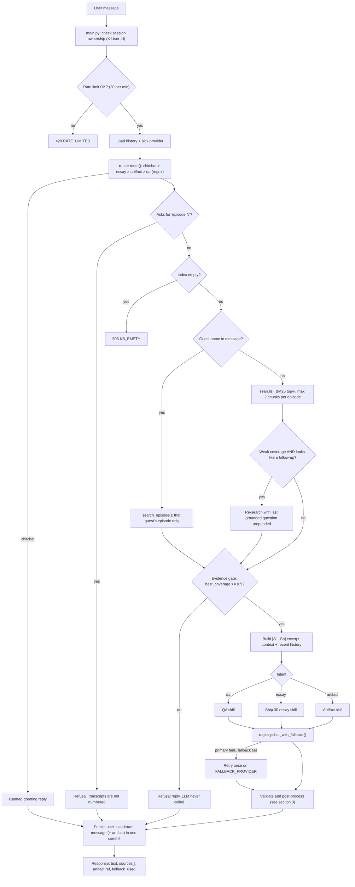
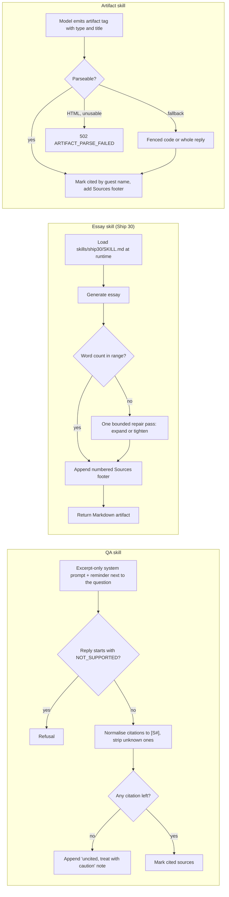

# Architecture Flow

How one chat message travels through the system, from the browser to the model and back.
Traced from `main.py`, `agent/router.py`, `agent/orchestrator.py`, `kb/index.py` and `llm/registry.py`.
For schema, API tables and security details see [architecture.md](architecture.md).

**The core idea:** the *code* decides routing, retrieval and refusal. The model only writes text from
excerpts it is handed. This is what keeps small local models (3-7B) reliable.

---

## 1. System topology

---

## 2. Request flow: `POST /api/sessions/{id}/messages`

A failed turn (503/504/502) **persists nothing**, so a retry never duplicates messages.

---

## 3. What each skill does after the model replies

---

## 4. Step-by-step reference

| # | Stage | Where | What happens |
|---|---|---|---|
| 1 | Auth scope | `main.py` | `X-User-Id` must own the session, otherwise 404 |
| 2 | Rate limit | `main.py` | Sliding window, 20 messages/min/user, else 429 |
| 3 | Route | `agent/router.py` | Regex, deterministic: chitchat, essay, artifact, qa |
| 4 | Short-circuits | `orchestrator.handle` | Chitchat reply, "episode N" refusal, empty-KB 503 |
| 5 | Retrieve | `kb/index.py` | Guest named: search that episode. Else BM25 top-k, 2 chunks/episode max |
| 6 | Follow-up repair | `orchestrator.py` | Only if coverage is weak *and* message looks like a follow-up: prepend last grounded question |
| 7 | Evidence gate | `orchestrator.py` | `best_coverage < MIN_QUERY_COVERAGE (0.5)` returns a refusal with no LLM call |
| 8 | Generate | `llm/registry.py` | Chosen provider, one retry on `FALLBACK_PROVIDER` if set |
| 9 | Validate | skill functions | Citation check, word-count repair, artifact parse |
| 10 | Persist | `main.py` | User message, assistant message and artifact saved in one commit |
| 11 | Render | frontend | Artifacts are sanitised on read (`nh3`) and shown in `<iframe sandbox="">` |

## 5. Failure paths

| Condition | Result |
|---|---|
| Index empty or still ingesting | 503 `KB_EMPTY` |
| Retrieval too weak | Refusal message, no model call |
| Model says `NOT_SUPPORTED` | Refusal message |
| Provider down, fallback configured | Transparent retry, message badged "fallback used" |
| Provider down, no fallback | `LLM_UNAVAILABLE` / `LLM_TIMEOUT` with Retry in the UI |
| Model returns no usable HTML artifact | 502 `ARTIFACT_PARSE_FAILED` |
| Too many messages | 429 `RATE_LIMITED` |

## 6. Notes on drift between code and docs

Spotted while tracing the flow; worth a quick sync of `architecture.md`:

* A **Groq** provider exists in `llm/groq_provider.py` and the registry, but `architecture.md` only lists Ollama and Anthropic.
* The **429 `RATE_LIMITED`** limiter is in `main.py` but missing from the error-code list in `architecture.md`.
